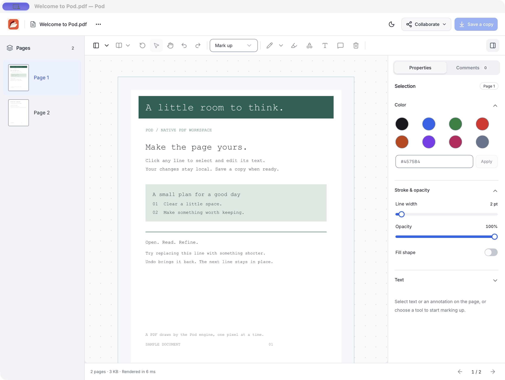

<p align="center">
  
</p>
<h1 align="center">Pod</h1>

Pod is a PDF editor for macOS with its own Zig engine. You can replace a line of text, mark up a page, rearrange a document, or draw with someone on a second Mac. The same engine powers a command-line tool for inspecting and editing PDFs.

**Start with the bundled sample.** Pod is a developer preview. It renders supported text, vector graphics and images, including JPEG and CCITT images found in scanned PDFs. Text search and selection require an existing text layer. Encrypted PDFs, CFF fonts and interactive form fields remain unsupported. See the [engine progress report](docs/engine-progress.md) for tested formats and limitations.



## What you can do

| Task | In Pod |
| --- | --- |
| Edit text | Select a text run and type a replacement that fits its original horizontal or vertical advance. The next run keeps its position. |
| Read and review | Find a passage, switch to **Reflow text** for reading, or open **Highlights & notes** to jump back to a marked passage or comment thread. |
| Write in the margins | Add a multiline text box, choose **Auto fit**, or reply to a sticky note. Supported imported text boxes retain their font, character spacing, word spacing and horizontal scaling after edits and saving. |
| Mark up a page | Highlight, underline, strike through, add shapes and Unicode comments, or press **F** to draw. Erase part of a stroke or select the drawing to move, rotate, or restyle it. |
| Organize pages | Merge documents, extract a page range, split a document, reorder pages, rotate, or crop. Cropping changes the visible area. The underlying content remains in the file. |
| Draw together | Connect two Macs directly to see each other's ink and cursors. Each person can undo their own strokes and save a copy of the result. |

## Quick start

Use an Apple Silicon Mac running macOS 14 or later. Install the Xcode Command Line Tools, Python 3, Node.js 22.12 or later with npm, and Zig **0.17.1**. Put `zig` on your `PATH`.

```sh
git clone https://github.com/kai1303/pod.git
cd pod
./script/build_and_run.sh
```

Pod opens a two-page sample. On the first page, select “Make the page yours.” and replace it with “Hello, Pod.” Press **F** and circle the new text. Choose **File → Save a Copy** to write your edited PDF. Use **File → Open Sample** to try again.

For a build without launching the editor, run `./script/build_and_run.sh --build`. The script produces `dist/Pod.app` with its interface and sample bundled inside.

## Draw with someone on a second Mac

1. Open a supported PDF of up to 32 MiB. Choose **Collaborate → Share Drawing** and enter an address and TCP port the other Mac can reach. On the same Wi-Fi network, use the host Mac's LAN address.
2. Send the private `pod://draw` invitation to your collaborator. With the same Pod build, they can open the link or paste it into **Collaborate → Join Drawing**.
3. Draw on either Mac. Pod sends the starting PDF and synchronizes freehand ink over a direct TLS connection. Choose **Save a Copy** before quitting to keep the drawings.

The invitation admits one guest. Outside the LAN, the host needs a reachable address and an open or forwarded port. The session runs directly between the two apps. [Drawing protocol and design](docs/superpowers/specs/2026-11-04-direct-drawing.md)

## Try the CLI

From the repository root, create a PDF, inspect its text runs, and replace the first run on page 1. Use fresh output filenames each time.

```sh
zig build -Doptimize=safe
./zig-out/bin/pod create original.pdf 'Hello world'
./zig-out/bin/pod inspect original.pdf
./zig-out/bin/pod replace original.pdf edited.pdf 1 0 'Hi'
./zig-out/bin/pod inspect edited.pdf
```

Page numbers start at **1** and run IDs start at **0**. Compare the second run in the two JSON outputs. Its starting position stays the same even though the first run is shorter.

## How the pieces fit together

| Start here | What to look for |
| --- | --- |
| [Zig engine](src/) | Parses PDF objects, interprets page content, edits text and annotations, and writes the result. Start with [the library entry point](src/pod.zig). |
| [macOS app](macos/) | Owns the document, file dialogs, editing history, peer connection, and native page canvas. The canvas uses Metal where available and can fall back to the Zig CPU renderer. |
| [Editor interface](web/docs/native-editor.md) | React controls run inside a bundled WKWebView. Toolbar actions cross a local bridge to the native editor. |
| [Checks and benchmarks](docs/benchmarks/) | Independent PDF-reader checks and dated measurements of the engine and editor. |

### Run the checks

```sh
zig build test                              # Zig parser, editor, and writer
POD_ZIG="$(command -v zig)" ./script/test_macos.sh  # Native app, bridges, PDF output, shared ink
./script/test_react_editor.sh --built       # Bundled editor, after the native build
```

For text-box compatibility, run `./script/test_freetext.sh --built` after building the app. The suite uses `uv` to install its Python test dependencies. It checks editing and reopening PDFs, compares CPU and Metal rendering, and verifies saved output with independent PDF readers.

<details>
<summary><strong>PDF compatibility and Zig library ownership</strong></summary>

### Supported PDF subset

- Classic cross-reference tables, cross-reference streams, hybrid-reference files, incremental revisions, and compressed object streams. Linearized layouts are read through their reference sections. Ordinary indirect references include indirect stream lengths. Saved copies consolidate the current reachable objects into one classic cross-reference table.
- PDF null, booleans, integers, decimal reals, names, escaped/nested literal strings, hex strings, arrays and dictionaries.
- Page trees with inherited resources, media boxes, crop boxes and quarter-turn rotation; content streams and arrays of streams.
- Flate, LZW (both `EarlyChange` variants), ASCII85, ASCIIHex, and RunLength stream decoding, including filter chains and indirect filter parameters. Flate and LZW support PNG and TIFF predictors with 1/2/4/8/16-bit components. Text edits write a decoded stream with consistent filter metadata.
- All 14 standard, unembedded Type 1 faces: Courier, Helvetica and Times styles, Symbol and ZapfDingbats. Built-in encodings, WinAnsi, PDF MacRoman, glyph-name Differences and explicit Widths are supported. Text extraction returns UTF-8; replacement accepts characters representable by the original font and preserves following text positions. ToUnicode streams support individual and ranged UTF-16BE mappings, ligatures, supplementary characters, compressed data and embedded UseCMap inheritance.
- Simple embedded TrueType fonts (`FontFile2`), including subset names, compressed programs, Unicode and symbolic mappings using supported cmap formats 0/4/6/12, and compound glyphs. The Zig engine reads and renders the embedded outlines without host fonts. Edits retain the embedded program and original PDF widths; replacement characters must already exist in the embedded subset and encoding. Type1/CFF programs, OpenType `FontFile3`, arbitrary unembedded fonts, predefined CMaps other than Identity-H/Identity-V and complex shaping remain unsupported.
- Composite Type0 fonts using Identity-H, Identity-V or supported embedded horizontal/vertical Encoding CMaps, embedded CIDFontType2 TrueType programs, and ToUnicode. Source codes of one to four bytes, identity/stream CID-to-glyph maps, default and per-CID widths, supplementary Unicode and ligature extraction, rendering and replacement share the same native path. Embedded maps support character/range mappings, overrides, UseCMap inheritance and explicit notdef mappings for unmapped codes. Fonts without a TrueType cmap table work when the PDF supplies glyph IDs. Vertical writing uses DW2/W2 origins and advances, character/word spacing and TJ adjustments; shorter edits preserve following text positions. Other predefined CMaps remain unfinished.
- `BT ET Tf Tm Td TD T* Tc Tw Tz TL Ts Tr Tj TJ q Q cm`. Rendering modes 0–3 are recognized; text clipping modes are rejected. Font size and horizontal scaling must be positive.
- Basic path construction, painting, line-width and device-color operators are preserved. Ordinary Form XObjects, clipping, colors and external graphics state have the support described below. Inline images have the support described below. Marked content remains unsupported.

Encrypted documents and unsupported stream filters have explicit unsupported errors. Unsupported data is not silently skipped. Content-array state can continue between streams, but a single operand/operator expression must be contained within one stream. The renderer supports basic paths and supported standard/embedded PDF text using unhinted outlines, plus annotations created by Pod and standard imported text markup. It does not shape complex text, load arbitrary PDF fonts, reconstruct paragraphs or reflow text. Pod renders imported highlights with multiply blending and follows each marked line for underlines, strikethroughs, and squiggles. Select a marked line to change its color, opacity, position, size or plain-text note, then use Save a Copy. Editing the appearance generates a fresh PDF appearance stream. A note-only edit preserves the original stream. The current import supports visible, unlocked text markup with RGB or grayscale colors on otherwise supported PDFs. Imported ink supports bounded InkList geometry and recognized appearances. Sticky-note, foreign vector-shape and FreeText import are described below; other foreign markup types remain outside this subset.

Path clipping supports `W` and `W*`, including curved and intersecting paths, holes, nested clips and graphics-state restoration. Fills, strokes and glyph outlines share clipped vector geometry across CPU and Metal; page clipping does not hide independent annotations. `script/test_clipping.sh` checks native/indexed opening, save/reopen and independent MuPDF rendering. Text clipping modes and broader image codecs/annotation appearance features remain unfinished. Complex intersections return `ClippingLimit` when bounded geometry or work budgets are exceeded.

Graphics-state resources (`gs`) support separate fill/stroke opacity, all 16 standard RGB blend modes, line width/caps/joins/miter, font selection and text knockout. Compatible aliases Normal; blend-mode arrays choose the first recognized mode or Normal when none is recognized. Overlapping glyphs within a text object and combined fill/stroke operations retain their initial backdrop on CPU and Metal. State restores with `q`/`Q` and continues across content streams. `script/test_graphics_state.sh` and `script/test_blends.sh` check native/indexed reads, saved appearance, annotation isolation and independent MuPDF/Ghostscript rasters, including ReportLab-produced content; their producers/readers are test-only dependencies. Soft masks, transparency Form groups, overprinting and general rendering intents remain unfinished and report explicit errors. Knockout rendering lazily retains backdrop rows, bounded by an additional 128 MiB at the maximum bitmap size, excluding geometry and other allocations.

Dashed strokes support direct `d` operators and external graphics-state `/D` entries, including odd-length patterns, normalized phases, zero-length dots, all cap/join styles, closed seams, transformed paths and hairlines. Dash spacing stays in user units, restarts per subpath and follows saved/restored graphics state. CPU and Metal use the same outlined geometry; large paints use tile-row edge subsets without splitting their opacity or knockout operations. Patterns are bounded to 128 entries and one million splitting steps, with existing path/scene limits retained. `script/test_dashes.sh` checks native/indexed opening, independent MuPDF/PDFBox/Ghostscript rendering, save/reopen, crop/rotation, page assembly, malformed data and a dense-grid preview. The editor smoke opens ReportLab-produced dashes and a dense grid on both renderers. This does not add dashed link borders or new annotation border-style controls.

Ordinary Form XObjects (`Do`) render recursively with their Matrix, BBox clip, local resource scope and inherited graphics state. Nested text retains source spans for extraction and shorter replacements; edits reject streams shared by multiple page executions or annotation appearances. Indexed page views reject text edits. CPU and Metal share form geometry, including nonuniformly scaled and skewed strokes. `script/test_forms.sh` checks independent hand-built and ReportLab files, save/reopen, text edits, clipping, resource isolation, crop/rotation and page assembly. Transparency groups, optional-content Forms and reference/OPI Forms remain explicit unsupported errors. Sampled image XObjects use the image path described below. The isolated normal-appearance previews described below reuse this path; full imported-annotation display in the page viewer remains unfinished. Form execution is bounded to 64 nested calls, 16,384 invocations, one million operators/parsed syntax nodes and 256 MiB of processed stream bytes per page, counting repeated execution. Nearly singular nonuniform stroke transforms return an explicit error.

Sampled image XObjects now render through Pod's Zig CPU renderer and Metal scenes, including images nested in Forms and supported comment appearances. Supported samples are 1/2/4/8/16-bit grayscale/RGB, calibrated spaces or supported ICC-based spaces, with existing stream filters and predictors, decode arrays, nearest/bilinear sampling, stencil masks and color-key transparency. Source rows, affine placement, clipping, opacity and blend modes share the page rendering path. Saves and page assembly preserve original image dictionaries and encoded bytes. `script/test_images.sh` checks full/indexed native reads, CPU/Metal output, independent MuPDF rasters, saved image preservation, rotation, page assembly and malformed inputs. The app smoke suite opens an image page, zooms, adds an annotation, undoes it and rotates the view on both renderers. JPEG/DCT support is described below. JPEG 2000, JBIG2, CMYK image colors and image-editing UI remain unfinished. Image masks are described below. Image dimensions are limited to 65,536 per axis, 16 million pixels and 64 MiB decoded sample data; each content execution is bounded to 256 MiB of expanded RGBA work, counting repeated invocations. Older paint-only C collectors reject image content; the native app uses the image-capable scene API.

Inline images (`BI` / `ID` / `EI`) now share the same CPU/Metal image renderer. Pod accepts standard dictionary/filter abbreviations, packed grayscale/RGB samples, stencils, inline Indexed palettes and named resource color spaces. The existing Flate, LZW, ASCIIHex, ASCII85, RunLength, JPEG and CCITT filters work in inline images, including filter chains and predictors. Unfiltered dimensions or codec end markers determine the exact byte boundary, so binary ` EI ` samples are preserved. Decoding uses temporary storage; repeated renders do not grow the document's decoded-stream cache. `script/test_inline_images.sh` checks independent ReportLab/Pillow/libtiff files, malformed framing, text edits around images, save/reopen, page assembly and CPU/Metal output. Compatible `PageMode`/`PageLayout` settings and page transition dictionaries survive page assembly; conflicting viewing settings still fail explicitly. Broader document catalog preservation and image-editing UI remain unfinished.

JPEG image streams (`DCTDecode`) now use an owned Zig decoder for 8-bit baseline, extended sequential and progressive Huffman JPEGs with grayscale or three color components. It handles interleaved, separate and mixed scans, progressive spectral bands and successive refinement, restart markers, optimized Huffman tables, 8/16-bit quantization tables as permitted by the frame, chroma subsampling and PDF ColorTransform/Adobe APP14 rules. CPU and Metal use the decoded samples through the existing image pipeline; saved PDFs retain their original encoded JPEG streams. `script/test_jpeg.sh` uses Pillow/libjpeg-turbo, `cjpeg` and `jpegtran` as test-only producers/oracles, checks decoded samples, native/indexed reads, CPU/Metal equality, save/reopen and page assembly, and independently checks MuPDF rendering before/after save. Arithmetic, lossless, 12-bit and four-component/CMYK JPEGs remain unsupported. Progressive images are decoded from all supplied scans; optional smoothing that estimates untransmitted coefficients is not applied. Limits are 16 million pixels, 64 MiB component planes, an additional 256 MiB of progressive coefficients, 256 million coefficient visits, the stream output budget and 10,000 markers. JPEG decompression adds no production library dependency.

Monochrome scanned images can use `CCITTFaxDecode`: the owned Zig decoder handles Group 3 one-dimensional, mixed Group 3 and Group 4 coding, terminating/makeup runs, reference-line modes, optional/required EOLs, RTC/EOFB termination, byte alignment and BlackIs1 polarity. Decode parameters retain their PDF defaults, including null-valued optional entries. Explicit damaged-row recovery follows DamagedRowsBeforeError for Group 3 streams with EOL markers. `script/test_ccitt.sh` checks libtiff-produced scans, packed samples, CPU/Metal equality, filter chains, stencil masks, native save/reopen and page assembly. Valid rasters match MuPDF exactly; its damaged-row behavior differs and is checked separately against the specification. Optional uncompressed fax extensions remain unsupported. Limits are 65,536 columns/rows, 16 million pixels, the stream output budget and a bounded bit-processing budget. Original fax bytes and image dictionaries survive saves.

Color handling supports named DeviceGray/DeviceRGB and ICCBased gray/RGB matrix profiles (ICC v2/v4), sampled/gamma/parametric tone curves, component ranges and DefaultGray/DefaultRGB substitutions. Pod's Zig code converts profile colors to sRGB; native images and the Metal display surface are tagged sRGB. `script/test_colors.sh` compares against test-only LittleCMS and MuPDF and checks exact profile preservation after saves and text edits. It requires the macOS system profiles, Pillow and liblcms2. LUT/CMYK profiles, patterns, spot colors, other rendering intents and black-point compensation remain unfinished; unsupported profiles are reported explicitly.

CalGray, CalRGB and Lab color spaces now use owned Zig conversion to sRGB, with gamma/matrix decoding, declared Lab ranges and Bradford white-point adaptation. This covers vector/text colors, sampled images, Indexed palette bases and DefaultGray/DefaultRGB substitution. Lab images use their native component ranges for default Decode; Matte removal precedes color conversion. WhitePoint, BlackPoint, Gamma, Matrix and Range parameters are validated. Conversion uses relative colorimetry without optional black-point compensation, matching the ICC policy; source calibration dictionaries are preserved. `script/test_calibrated_colors.sh` checks against independent LittleCMS and PDF readers. MuPDF uses a fixed Lab space that ignores declared WhitePoint/Range; Lab checks use LittleCMS, and image checks use independently expanded RGB oracles while retaining source/save comparisons. Both this suite and the image/UI fixture generation require liblcms2. Other rendering intents, output-intent handling and black-point compensation remain unfinished.

Explicit image-mask streams and DeviceGray soft-mask images render on CPU and Metal, with independent image/mask resolutions and interpolation. Soft masks support 1/2/4/8/16-bit alpha, Decode mappings and Matte removal before color conversion. They override an image's Mask entry. Bounds account for transparency, and saves preserve encoded image/mask streams and dictionaries. `script/test_images.sh` checks these alongside existing images, including masks in Forms and comment appearances, JPEG masks and independent transparent-image producers. MuPDF and Ghostscript provide independent raster checks; two documented blend/interpolated-Matte cases use Ghostscript because MuPDF differs. General graphics-state soft masks and transparency groups remain unfinished.

Indexed color spaces support palettes over DeviceGray, DeviceRGB, calibrated spaces and supported ICCBased spaces, with direct/indirect string or filtered-stream lookup tables. Images accept 1/2/4/8-bit indices, Decode mapping, interpolation, color-key masks, explicit/soft masks and palette-based Matte colors; vector fills/strokes use the same palette conversion. Tables have at most 256 entries and must match their declared size. `script/test_images.sh` includes a Pillow-produced PDF and checks palette/image preservation. It additionally requires Java 8 or later and downloads a checksum-pinned, test-only PDFBox 3.0.5 reader for fractional Decode rounding and Indexed Matte, where other readers differ. Pillow's free object-zero generation 65536 is normalized to 65535; other overflowing generations remain invalid. Complete length-delimited ASCIIHex image streams may omit their end marker, but short sample buffers still fail.

Page assembly preserves compatible document Info metadata, including Unicode strings and scalar custom fields. It combines nonconflicting fields and rejects conflicting values, structured custom fields or unsupported document-level structures rather than losing them. Metadata assembly is limited to 1,024 distinct fields and one million visited entries. XMP and broader document navigation preservation remain unfinished.

Standard font metrics come from licensed Adobe AFM and glyph-mapping data; notices ship with the CLI and app. The native host supplies installed Courier New, Arial, Times New Roman, Symbol and ZapfDingbats outlines for Pod's Zig TrueType reader. These are substitute outlines; original PDF metrics control spacing. No system font files are bundled. Run `script/test_fonts.sh` for all-face rendering and independent PDFKit edit/reopen checks. New FreeText annotations use Courier with WinAnsi text, including accented Latin, euro signs and typographic punctuation; broader scripts still need font/shaping support. `script/test_unicode.sh` checks Unicode extraction and editing without changing glyph rendering; it uses PDFKit and a pinned test-only MuPDF reader for independent verification.

Comment contents created in Pod support Unicode, including Vietnamese, Chinese and emoji. New FreeText boxes support the WinAnsi character repertoire; older Pod text boxes retain their original ASCII-only editing path. Supported foreign sticky notes now open in the native editor, including notes without appearance streams. Missing appearances use original vector icons for Note, Comment, Key, Help, NewParagraph, Paragraph and Insert; missing or unknown names use Note. Existing appearance streams take priority, and malformed ones still fail explicitly. Their icons stay upright and fixed in size across zoom and view rotation, with matching hit regions on CPU and Metal. Select a note or use the comments pane to edit its text or delete it; undo/redo preserves view state. Text-only edits preserve appearance streams, author/review metadata and popup references. Imported note geometry and styling remain protected, and locked notes stay read-only. Double-click a note icon to open its popup. Popups show Unicode author/subject metadata, honor the saved initial open state and remain fixed in size during zoom and rotation. Closing or reopening a popup is viewing state and does not change the PDF; Edit Note uses the normal save/undo path. Rich-text notes remain readable but cannot yet be edited. Supported reply threads appear together in one popup, with nested replies, Unicode authors, editing and leaf deletion. Parents with replies cannot be deleted until their replies are removed. The notes navigator lists each supported thread root once and uses engine annotation IDs for navigation. Existing review-state metadata is preserved and displayed; changing review states, grouped annotations (`RT /Group`), unsupported appearance content and broader annotation types remain unfinished.

Imported rectangles (`Square`), ellipses (`Circle`), lines, polylines and polygons now open through their normal appearance streams on CPU and Metal. Select a shape to move it, edit its plain-text Unicode note or delete it, with undo/redo and save/reopen. Moving updates Rect and line/vertex geometry without rewriting shared appearance streams, named states, custom arrowheads, cloudy borders or resources. Note edits preserve appearance bytes and author/review metadata; PDFKit's stale private cache is invalidated. Custom imported appearances stay protected, and locked annotations remain read-only. Rectangles, ellipses, lines, polylines and polygons without appearances can be resized and restyled; those edits write a fresh standard appearance while preserving border settings and other metadata. Pod checks the saved appearance against the geometry and style before allowing further regeneration, so an appearance customized by another editor becomes protected. Their notes appear in the comments pane and notes navigator. `script/test_shapes.sh` checks MuPDF/PDFKit-produced shapes, transformed/shared/state appearances, independent renders, translation, protected edits, page operations and malformed data. The app smoke checks dragging, notes, delete/undo/redo and zoom/rotation on both renderers. Rectangles and ellipses without appearances render from their geometry, RGB/grayscale colors, opacity, rectangle insets and solid/dashed borders, including legacy Border arrays. Display and save do not add appearance objects. Existing appearances still take precedence. Line and polyline fallbacks include all ten standard endpoint styles, interior colors, inherited border dashes and line leader lengths/extensions/offsets. Polygon interiors remain separate from polyline endpoint fills. Regenerated bounds include stroke joins and markers, including horizontal and vertical paths; saved appearances remain editable after reopening. Regeneration of arbitrary foreign appearances, cloudy/rounded fallback borders, CMYK metadata colors, hidden/fixed-screen display flags and grouped annotations remain unfinished.

Plain-text line captions without appearances now render inline or above the line, including caption offsets, multiline labels, reversed/vertical lines and leaders. Saved appearances use Helvetica at 12 pt with WinAnsi text; accented Latin, euro signs and dashes are supported, while other scripts and rich text still require broader font/layout support. Editing a caption rebuilds its visible label, inline gap and bounds, and remains editable after saving. Unsupported text fails without changing the document. Custom imported caption appearances remain displayable and movable, but their text is read-only until Pod can safely regenerate them. The inspector explains this restriction. `script/test_captions.sh` checks placement, CPU/Metal rendering, caption edits, save/reopen, malformed inputs and independent saved-appearance rendering. FontTools and ReportLab are test-only dependencies for matching the reference reader's fonts.

Imported FreeText boxes with saved appearances now open on CPU and Metal, including alignment, embedded fonts, rotated text, rich formatting, named appearances and callouts whose appearance content is otherwise supported. They can be selected, moved and deleted with undo/redo and save/reopen. Moving translates both the annotation rectangle and two-/three-point callout coordinates without rewriting font resources or appearance streams. Custom imported appearances keep text/style/resizing protected, with an explanation in the inspector; Pod does not replace artwork or font resources it cannot reproduce. `script/test_freetext.sh` checks independent MuPDF/PDFKit producers, metadata preservation, callout movement, locked annotations, malformed inputs and independent rasters. PDFKit's missing font-stream Length fields are repaired only in test copies; the malformed originals remain rejection fixtures. The owned TrueType reader also accepts Apple's `true` scaler header with unchanged table/glyph validation.

FreeText boxes without saved appearances now render from fixed-size or automatically sized default text properties using the 14 standard fonts and recognized aliases, or supported fonts from document default resources. Layout supports left/center/right alignment, word wrapping, explicit line breaks, clipped overflow, quarter-turn text rotation, positive horizontal text scaling, signed character/word spacing, grayscale/RGB text and background colors, opacity, supported borders/insets and callout lines. Horizontal scaling and spacing affect glyph placement, wrapping, alignment and automatic fitting, and survive text/style edits and save/reopen. Word spacing follows single-byte code 32 even when the font maps it to another character; multibyte codes containing that byte do not receive word spacing. Spaced lines align their nominal glyph extents, excluding trailing separator advances. A bounded interval search handles auto-fit when negative spacing makes shrinking nonmonotonic; exhausting its budget of one million boundary checks reports TextLimit. Rendering leaves the source dictionaries unchanged, including absent appearances; moving and saving preserve the original formatting properties. Plain boxes without appearances can also be edited: text, font size, colors, border width, opacity and resizing produce a fresh standard appearance. Callout points and text insets follow resizing. These boxes remain editable after saving and reopening; Pod verifies both appearance drawing and resources before regeneration, so externally customized appearances become protected. Failed edits leave annotation dictionaries and object counts unchanged, and shared appearances are never overwritten. Unbreakable words remain on one clipped line, and trailing spaces do not shift alignment. A zero font size enables automatic fitting within the text area, accounting for wrapping, border padding, insets and rotation. The saved sizing mode stays automatic when text or box dimensions change. Leading, text rise, arbitrary text matrices, nonpositive horizontal scaling, vertical FreeText writing, rich text/default styles and complex-script shaping still require broader layout support and fail explicitly.

FreeText font names resolve through the catalog AcroForm's DR/Font dictionary before standard-font aliases. AcroForm dictionaries containing default resources and an optional empty Fields array can now open; interactive fields and XFA remain unsupported. Supported embedded TrueType and horizontal CID fonts retain their original resources, encodings and widths when text is edited, resized or automatically fitted. Wrapping follows decoded spaces and complete character codes, including mixed-length CMaps. Replacement text must be representable in the original font. Saved appearances retain exact indirect font references or equivalent direct dictionaries; substituted resources stay protected. Page extraction and reordering retain font-only default resources. Merging gives each source font a unique resource name and updates the corresponding FreeText DA references while preserving font programs and saved appearances. Interactive fields, XFA and non-font default-resource categories remain unsupported for page assembly.

New text boxes created in Pod use the same standard FreeText layout and saved appearances as editable imported boxes. They wrap words, accept explicit line breaks, clip overflow and preserve text/background colors, border width and opacity. Their text stays editable after saving, and resizing can reveal clipped lines. The Add Text sheet accepts multiple lines. Choose **Auto fit** in the font-size inspector for supported text boxes; fixed sizes remain available. Automatic fitting chooses a positive size up to 200 pt, with empty text capped at 12 pt; boxes with no usable interior fail explicitly. Creation stages the annotation, appearance and page reference together; allocation failures leave the page dictionary, object count and trailer size unchanged. Existing Pod text boxes retain their original saved appearances and editing behavior. `script/test_freetext.sh` checks both Pod-created and independent-producer boxes, including saved-appearance rendering in another reader.

Normal appearances resolve named states and map transformed Form BBoxes into annotation Rects, including nested Forms, clipping and supported transparency. The page-view API composites them against page content and previous annotations; output must be regenerated when magnification or rotation changes. Isolated opaque-on-white previews remain available separately. `script/test_comments.sh` checks CPU/Metal rendering, native editing and independent PDFKit/MuPDF preservation and compositing. `script/test_comment_icons.sh` checks fallback icons, fixed size, opacity and independent metadata/render preservation without adding AP streams. `script/test_comment_popups.sh` checks popup metadata through full/indexed native reads and independent preservation. `script/test_replies.sh` checks thread relationships, Unicode creation/editing, parent deletion protection, zero-sized nonvisual replies, save/reopen, page extraction and independent PDFKit/MuPDF verification. `script/test_react_editor.sh` checks actual editor interaction for notes with and without appearances on both renderers, popup viewing/editing, nested reply creation/editing/deletion, parent protection, undo/redo and rich-text protection.

Run `script/test_truetype.sh` for simple embedded-font checks and `script/test_cid_fonts.sh` for composite-font checks, including an independent fpdf2-produced subset. Both cover CLI/native editing, CPU/Metal rendering, malformed data and independent PDFKit/MuPDF verification. `script/test_encoding_cmaps.sh` additionally covers custom Encoding CMaps; it requires Ghostscript for the notdef fixture because MuPDF ignores that mapping. `script/test_vertical_fonts.sh` checks vertical metrics, placement and save/reopen with Ghostscript and MuPDF, including scaled and rotated text. Reader limitations are recorded in [engine progress](docs/engine-progress.md). fpdf2 is also a test-only dependency. FontTools and ReportLab generate test fixtures only; the production engine has no dependency on them. Embedded font coverage is still bounded: custom glyph names and `post`-table fallback, some Macintosh mappings, other cmap formats, and symbolic text extraction without ToUnicode remain incomplete.

Ordinary URI links now retain their targets and metadata across edits and saves. Pod supports borderless links and renders solid and underline borders and opens HTTP(S) targets on a native canvas click, including relative targets with a catalog base URI. Quad regions restrict clicks to the linked lines; dragging or using annotation tools does not open a link. Other URI schemes stay inactive. Internal page links support explicit destinations, legacy names and name trees, with all eight position/fit modes and native navigation. Action chains, structure destinations, custom link appearances and dashed/rounded borders still report explicit unsupported errors. Link creation/editing UI and extraction/merge of documents with named-destination catalogs or a catalog URI base remain unfinished; extraction that removes a linked target fails explicitly. Run `script/test_links.sh` for native and independent PDFKit checks.

Limits include 64 MiB per decoded stream, 256 MiB of retained decoded stream data per document handle, 16 filters per chain, 128 cross-reference sections, four million processed cross-reference records, 256 MiB input files, one million object slots, 100,000 pages, 64 nested syntax/page/reference/graphics levels, one million syntax nodes per parser, 1 MiB string/name tokens, 128 operands per operation, and finite numeric content operands bounded to magnitude 10¹². Page-tree nodes may be visited only once, rejecting both cycles and repeated sibling references. These are guardrails, not a claim that hostile PDFs have been exhaustively fuzzed or that peak memory is capped at input size.

### Using the Zig library

Import the `pod` module from `build.zig`:

```zig
const bytes = try pod.create(allocator, "Hello world");
defer allocator.free(bytes);
var document = try pod.Document.open(allocator, bytes);
defer document.deinit();
const pages = try document.inspect();
try document.replace(1, 0, "Hi");
const saved = try document.save(allocator);
defer allocator.free(saved);
```

The document **borrows** the input bytes: keep them alive and unchanged until `deinit`. Parsed objects, decoded strings, inspected pages/runs and edited content belong to its arena. Do not free them individually. After an edit, call `inspect` again for a current view; previously returned views are stale. `create` and `save` return slices owned by their supplied allocator. `save` rewrites objects reachable from the trailer and the xref/trailer; deleted annotation dictionaries and their unreferenced appearance streams are omitted. Saving is proportional to reachable objects and output size, and can fail on malformed reachable data.

</details>
