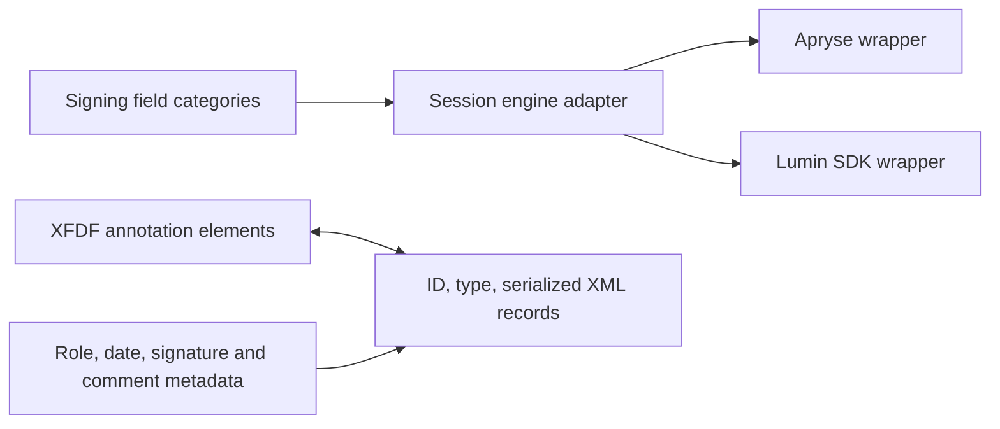

# Lumin PDF annotation inventory and implementation findings

Inspected on 4 November 2026 for Pod's native annotation milestone. The supplied PDF editor exposes **29 annotation and markup variants across the inspected menus**, plus **four form-field tools**. This is a count of user-facing operations, not distinct PDF annotation subtypes or a claim that every feature was exercised through export.

The corrected target was [the Lumin PDF editor](https://www.luminpdf.com/app/pdf/viewer/building-event-driven-microservices-636b09b620c811cc94d171a5). The earlier link opened a completed Lumin Sign agreement with editing controls locked. The distinction matters: the PDF editor's form builder and the Sign application's field catalog differ.

## Count and counting rules

| Group | Count | Observed variants |
| --- | ---: | --- |
| Shapes and symbols | 10 | Rectangle, ellipse, line, arrow, polyline, polygon, cloud, star, cross, tick |
| Text markup and highlights | 5 | Text highlight, freehand highlight, underline, squiggly underline, strikethrough |
| General annotation tools | 4 | Freehand drawing, typed text, image, comment |
| Additional Fill and Sign tools | 4 | Dot, stamp, date, signature |
| Measurements | 6 | Distance, angle, perimeter, polygon area, rectangle area, circle area |
| **Total** | **29** | Repeated toolbar entries counted once |

Cross, tick and typed text occur in multiple menus and are deduplicated by their user-facing purpose. This does not establish that their different toolbar implementations use the same native object class. Stamp carries a premium badge. Colors, opacity, line thickness, signature placement repetition, and styling presets are settings, not additional annotation types.

The measurement toolbar exposes six creation modes. Its properties panel includes precision, distance, angle, axes, line styling and opacity; snapping and scale controls are separate settings.

The **PDF editor's form builder exposes four fields**: text box, checkbox, radio button and signature. Its Apply button remained disabled during inspection, and the builder was exited with Cancel.

The **Sign bundle declares six field categories**: `SIGNATURE`, `INITIALS`, `TEXT`, `DATE`, `CHECKBOX`, `DROPDOWN`. These are a separate product/workflow inventory and are not added to the editor's 29.

Excluded from the annotation count: eraser, OCR, editing original text, page organization, password protection, AI tools, and redaction. A `linkButton` was also observed in the editor's contextual DOM controls, but its visible workflow was not exercised; 29 is the inspected menu inventory, not an exhaustive capability ceiling. Redaction is visible as a premium security tool and requires its own content-removal investigation.

## What the UI reveals

The editor groups tool state into Popular, Fill and Sign, Mark up, Edit text, Security, and Organize. Explore exposes the broader tool directory and shortcuts. Shape, drawing, text-markup and comment menus share style controls; the ten shapes share a single palette with fill, border and opacity.

Observed DOM identifiers include `shapeToolGroupButton`, `freeTextToolButton`, `rubberStampToolButton`, `dateFreeTextToolButton`, `signatureToolButton`, `formBuilderButton`, `stickyToolButton`, `textHighlightToolButton`, `textUnderlineToolButton`, `textSquigglyToolButton` and `textStrikeoutToolButton`.

The ten shape icons identify rectangle, ellipse, line, arrow, polyline, polygon, cloud, star, cross and tick directly through their `pdf-icon-md_*` class names. The measurement controls identify angle, perimeter and three area geometries through their `kiwi-icon-*` names; the selected first mode is labeled Distance measurement in its properties panel.

These observations establish exposed controls and grouping. Creation, modification, persistence and exported PDF representations were not tested on the user's document.

## Findings from the shipped signing code

Selected JavaScript was read from the original Sign tab using Chrome DevTools `Debugger.getScriptSource`. These findings apply to those signing modules, not automatically to the active backend of the corrected PDF editor.

### An engine adapter boundary

`annotation-f1srrya2.chunk.js` contains an Apryse instance wrapper which obtains `window.Core`, initializes PDFNet and a `DocumentViewer`, exposes annotation and field managers, and disables embedded JavaScript. Its creation path rejects a session whose engine kind is `lumin`.

`viewer-instance-facade-tewcg8m8.chunk.js` takes the complementary branch: when the session kind is `lumin`, it dynamically imports `LuminViewerInstance`; otherwise it rejects the request. This establishes two implementation paths in the shipped Sign code. It does **not** prove which path is active for this document or that both are enabled for every account.

The browser asset inventory also observed WebViewer core paths containing version `11.9.1` in Sign and `11.13.0` in the PDF workspace. Loading a library is not proof that it is the active engine for every operation.

### XFDF records and field metadata

The selected annotation module's function `F` parses an XFDF `annots` element and converts each child into a record with:

```text
uniqueId     <- the XML annotation's name attribute
type         <- the XML element name
xfdfCommand  <- the serialized annotation element
```

Function `P` performs the reverse composition: it parses an existing XFDF document, creates `annots` if missing, and appends each record's serialized XML. Form-builder records use the `xfdf` container instead. This is direct source evidence of XML-to-record conversion and reconstruction; a successful live save or network synchronization was not observed.

The widget module defines metadata keys for editor/role identity, signature and text categories, date format/autofill, field creation/override state, names/indicators, user color, and linked highlight/sticky/pin comments. It also normalizes checkbox values to `Yes` and `Off`. The annotation module recognizes field codes `Sig`, `Tx`, `Btn` and `Ch` when filtering form data.

The selected source therefore supports this partial model:



The connection from these records to server storage, conflict resolution, undo history, flattening and final PDF export remains unverified.

## Implications for Pod

Pod should implement shared annotation geometry, style, selection and serialization so that multiple toolbar variants reuse the same primitives. The observed palette is a useful product inventory, while its implementation remains independent of Lumin's code.

A practical delivery sequence is:

1. Read and preserve existing annotations; add rectangles, ellipses, lines/arrows, polylines/polygons and freehand paths.
2. Add text markup, typed text and comments, including stable IDs and appearance generation.
3. Add image/stamp/date/signature appearances and symbol presets.
4. Add form fields and measurement geometry, units and scale metadata.
5. Validate edit/save/reopen and external-reader rendering for every supported kind, with flattening and redaction tested separately.

This is a proposed Pod sequence derived from the inventory. No annotation implementation or vendor source was added to Pod's engine during this investigation.

## Evidence and boundaries

| Evidence | Scope |
| --- | --- |
| Browser UI observations | Corrected PDF editor: Popular, Mark up, shape/text/highlight/style menus, measurement panel, Fill and Sign, form builder, Security and Explore |
| Browser source observations | Selected modules from the original completed Sign document; includes the widget catalog, XFDF functions and adapter branches |
| [UI inventory](evidence/ui-inventory.json) | Structured transcription of observed controls and counting rules |
| [Source provenance](evidence/source-provenance.json) | Capture method, original asset URLs, retained source scope and SHA-256 hashes |
| [REA summary](evidence/selected-source-summary.json) | Static analysis of one complete selected widget module and selected XFDF functions |
| [REA complete evidence](evidence/selected-source.bundle.json) | Retained parent Evidence `ev_72f51f3758bea8af8c69f1c28793d0541292b2ffbf10b2d1cf03fe6cf445c122` |

REA 6.8.0 parsed both selected files without parse failures, totaling 2,288 bytes and 580 AST nodes. Its semantic coverage remains partial/unknown with 108 unresolved semantic records; this is not reconstruction of the whole application. The XFDF file is explicitly an excerpt with imports and other functions excluded.

The REA MCP connector was unavailable in this session. Static analysis used the CLI with the existing bundled Node 24.22.1 runtime; no MCP configuration or analysis engines were installed. Direct CDN acquisition returned HTTP 403, so retained source evidence comes from already-loaded browser scripts. Raw debugger access became unavailable after later navigation, limiting deeper editor tracing.

No annotations, signatures, fields or comments were placed; no save, sharing, upload, signing or export operation was executed. The document still displayed **Edited Oct 19** at the end of inspection. The added research tab was closed, and the user's PDF editor tab was left open.
